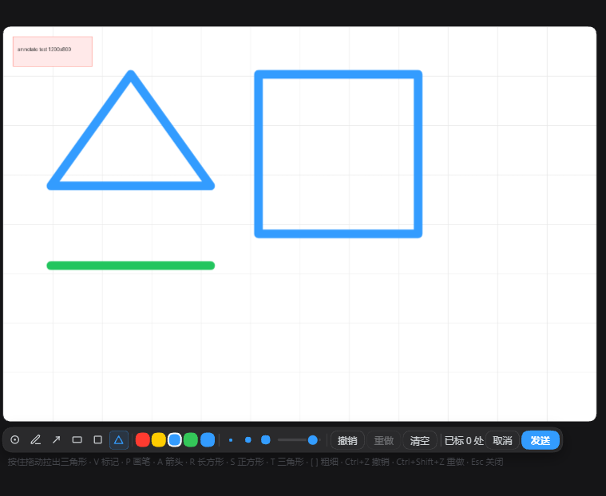

# dsh-sidebar-annotate — DeepSeek Harness 右侧栏图片批注 / Sidebar image annotation

English · [简体中文](README.zh-CN.md)

Annotate images in place inside the DeepSeek Harness right sidebar: mark, draw, arrow, rectangle, square, triangle → the composited image plus a numbered note list goes back to the conversation.

Maintained by HuaLQIn · First released on 2026-10-31 (v0.6.2). Where to report issues: [this repository's issues](https://github.com/HuaLQIn/dsh-sidebar-annotate/issues).

## What it does

Open an image in the right sidebar and the preview header gains an **Annotate** button. Click it and the image becomes drawable: the ink layer sits exactly on top of the picture where it already is, with a toolbar capsule under it. Nothing is moved, nothing is dimmed, no centred dialog opens.

When you send, the plugin composites the original image with your ink, numbers every marker, and hands the result to the conversation together with a note list:

```
I marked spots on this image:
1. the button in the top right
2. the spacing here
The numbers in the image match the list above.
```

## Features

| Feature | Description |
| --- | --- |
| Annotate in place | The layer measures the previewed `` rectangle and paints a canvas at the same coordinates; zoom, scroll and the official renderer are untouched |
| Six tools | Mark (click to drop a numbered marker and write one line), pen, arrow, rectangle, square, triangle |
| Corner-first shapes | Press and drag from a corner; the square locks to equal sides and takes the longer edge |
| Colour and width | Four presets plus a custom picker; three preset width dots plus a continuous 1–12 px slider, both editing the same value |
| Undo and redo | Ordered by when you did things, not by category; a marker added after a stroke is undone before the stroke |
| Numbered markers | Blue circle with a white ring and a white number, anchored to normalised coordinates so it survives window resizes |
| One-shot send | Original image + ink exported as PNG (downscaled past 4096 px on the longest side), attached through the official draft path and submitted with your note list |
| Keyboard first | `V P A R S T` for tools, `[` `]` for width, `Ctrl+Z` undo, `Ctrl+Shift+Z` / `Ctrl+Y` redo, `Esc` to back out; the hints sit under the capsule |
| IME safe | Keys are ignored while the note card is focused; no keystroke is swallowed while you type |
| Auto close | Three consecutive failed image lookups (≈1.2 s) close the layer; switching files in the same tab clears stale ink |

## Interaction flow

```
Open an image in the right sidebar
        │
        ▼
Preview header: [Annotate]  ──▶  toolbar capsule appears under the image
        │
        ├── Mark    : click → numbered marker → type one line
        ├── Pen     : hold and drag
        ├── Arrow   : hold and drag → arrowhead at the end
        ├── Rect    : hold and drag from the corner you pressed
        ├── Square  : same, sides locked equal
        └── Triangle: same, base at the bottom, apex centred
        │
        ▼
[ Send ]
        │
        ▼
Composite PNG (original + ink + numbers)  +  numbered note list
        │
        ▼
Lands in the conversation through the same path as pasting an image and pressing Enter
```

## The panel

A single translucent capsule under the image, left to right: six tool cells — colour swatches with a custom picker — three width dots and a slider — undo, redo, clear — marker count — cancel, send. Key hints render below the capsule on an absolutely positioned line so the capsule never grows into two rows.

## Demo



A real session: rectangle, square, triangle and a pen line drawn on a test image, with the toolbar capsule underneath — six tools, colour presets plus a custom picker, three width dots and the slider, undo / redo / clear, the marker count, cancel and send.


## Install

Not published to npm. Install straight from this repository:

```bash
# recommended — install from this repository
dsh plugin --profile <your-profile> add git+https://github.com/HuaLQIn/dsh-sidebar-annotate.git

# or — clone, then install from a local path (development)
git clone https://github.com/HuaLQIn/dsh-sidebar-annotate.git
cd dsh-sidebar-annotate
dsh plugin --profile <your-profile> add .
```

`<your-profile>` is the profile you actually run: `web` for the browser build, `desktop` for the desktop app.

**Then fully quit and reopen the host.** The client bundle is composed at boot; reloading the window does not pick up a new plugin build.

### Package name

The package is `dsh-sidebar-annotate`. The CLI writes two places for you: the profile `package.json` dependency and the `dsh.profile.bundles` entry. Do not install a second copy under a different name — the two would register the same slot and both toolbars would render.

## Requirements

- Node.js 20 or newer (`engines.node` in `package.json`)
- A DSH build that provides the `sidebar.right.tab.document.actions` slot (introduced with the document-preview package)
- Tested against DeepSeek Harness desktop `0.2.1-rc.2` with a web client build; other versions are untested

`package.json` deliberately declares **no `engines.dsh` and no `@deepseek-ai/*` peer dependencies**. A strict semver range rejects pre-release host versions such as `0.2.1-rc.2`, and the install is skipped without any error message — silence, not a failure you can see.

## Keyboard

| Key | Tool or action |
| --- | --- |
| `V` | Mark |
| `P` | Pen |
| `A` | Arrow |
| `R` | Rectangle |
| `S` | Square (equal sides) |
| `T` | Triangle |
| `[` / `]` | Width preset down / up |
| `Ctrl+Z` | Undo the last action |
| `Ctrl+Shift+Z` / `Ctrl+Y` | Redo |
| `Esc` | Close the note card, then the layer |

## Do / Don't

| Do | Don't |
| --- | --- |
| Install with `dsh plugin add` and let it write both places | Insert the same id again by hand in `cordis.patch.yml` |
| Fully quit the host and reopen after installing | Assume a window reload picked up the new build |

Self-check after installing:

```bash
dsh --profile <your-profile> --dump-config | rg "id: dsh-sidebar-annotate"   # exactly one line
```

In the browser console of the running host:

```js
window.__DSH_BOOT__.entries.find(({ id }) => id === 'dsh-sidebar-annotate')
// should return an entry with a url; if undefined, the plugin did not load
```

## Compatibility notes

- Images only: png, jpg, jpeg, webp, gif, bmp, ico. PDF, browser tabs, element picking and text annotation are not implemented.
- No eraser, background removal or resize — that is image editing, not annotation, and it belongs to a different toolbar.
- The composite keeps the natural image size. A picture whose longest side exceeds 4096 px is downscaled before export so the sidebar does not allocate hundreds of megabytes.
- Undo removes whole strokes and whole markers. There is no partial erase.
- When the image scrolls out of the viewport the layer hides and keeps its state.
- If the conversation is busy submitting, attachments are refused and the layer reports it instead of queueing silently.
- Very large images may take a moment to export; the send button shows a sending state meanwhile.

## Uninstall

```bash
dsh plugin --profile <your-profile> remove dsh-sidebar-annotate
```

Or delete the dependency line and the `dsh.profile.bundles` entry from the profile `package.json` by hand, then fully quit and reopen the host. No files outside the profile are touched. Annotation state lives in memory only and is discarded when the layer closes, so there is nothing left to clean up in the browser.

## Version history

| Version | Highlights |
| --- | --- |
| 0.6.2 | Shape drag reverted to corner-first after real use; the centre-out variant is kept in the source tree as an alternate build |
| 0.6.1 | Shapes briefly drawn from the pointer position outward as a centre anchor |
| 0.6.0 | Toolbar rebuilt to the caption-capsule look; continuous width slider; custom colour; redo added |
| 0.5.0 | Six tools with keyboard shortcuts; three width presets; undo ordered by action sequence |
| 0.4.x | Main mode became the numbered-marker + note-card flow; pen kept as a secondary mode |
| 0.1.0 – 0.3.0 | In-place annotation layer, pen, arrow and box; earlier versions used a centred dialog |

## Design reference

The annotation feature inside the Codex desktop app (internal codename *popcorn*) was read from its own `app.asar` and used as the visual reference: accent `#339CFF`, 2 px dashed selection outline with 10 % fill, marker with `border-radius: 50% 50% 50% 3px`, a custom SVG cursor with hotspot 13,12, and the caption capsule (`rounded-full`, translucent, backdrop blur, 1 px ring). No code was copied — only the visual language.

## Contributing and security

- How to make a change and what to check first: [CONTRIBUTING.md](CONTRIBUTING.md)
- Reporting a vulnerability privately: [SECURITY.md](SECURITY.md)
- Community expectations: [CODE_OF_CONDUCT.md](CODE_OF_CONDUCT.md)

## License

MIT. See [LICENSE](LICENSE).
