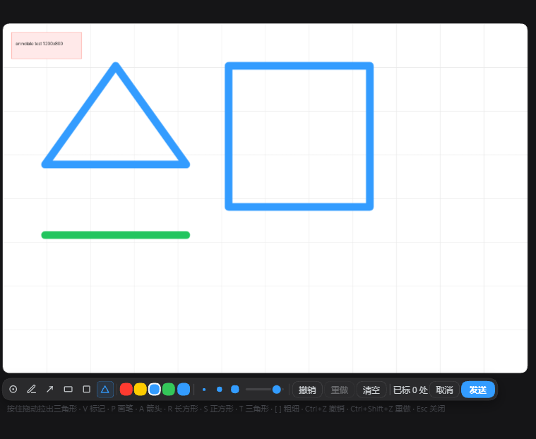

# dsh-sidebar-annotate — DeepSeek Harness 右侧栏图片批注 / Sidebar image annotation

[English](README.md) · 简体中文

在 DeepSeek Harness 右侧边栏里**原地**批注图片：标记、画笔、箭头、长方形、正方形、三角形 → 合成图和编号说明一起发回对话。

维护：HuaLQIn · 首次发布 2026-10-31（v0.6.2）。问题反馈：[本仓库 Issues](https://github.com/HuaLQIn/dsh-sidebar-annotate/issues)。

## 它做什么

在右侧边栏打开一张图片，预览头部会多出一个**批注**按钮。点开之后图片就变成可画的：墨迹层精确覆盖在图片本来的位置上，下面浮着一条工具栏胶囊。图不移动、不加遮罩、不弹居中对话框。

发送时，插件把原图和笔迹合成一张图，给每个标记编号，连同说明列表一起交给对话：

```
我在这张图上标了几处：
1. 右上角那个按钮
2. 这里的间距
图上的数字和上面编号一一对应。
```

## 功能

| 功能 | 说明 |
| --- | --- |
| 原地批注 | 量出预览 `` 的屏幕矩形，在同坐标铺一层画布；缩放、滚动与官方渲染器都不动 |
| 六种工具 | 标记（点一下落编号并写一句）、画笔、箭头、长方形、正方形、三角形 |
| 从角起画 | 按住拖动，从按下那个角开始；正方形锁等边，取长边 |
| 颜色与粗细 | 四个预设 + 自定义取色；三个预设粗细点 + 一条 1–12px 连续滑轨，两种控件改的是同一个值 |
| 撤销与重做 | 按动手先后撤，不按类别；先画一笔再标一处，先撤的是标记 |
| 编号标记 | 蓝底白环白字的圆点，按归一化坐标锚定，改窗口大小不跑偏 |
| 一次发出 | 原图 + 笔迹导出 PNG（最长边超过 4096px 时等比缩），走官方草稿链路挂附件并带着说明列表提交 |
| 键盘优先 | `V P A R S T` 切工具，`[` `]` 调粗细，`Ctrl+Z` 撤销，`Ctrl+Shift+Z` / `Ctrl+Y` 重做，`Esc` 逐层退出；键位提示挂在胶囊下方 |
| 输入法安全 | 焦点在说明卡里时不抢键，打字不会被吞 |
| 自动收工 | 连续三次（约 1.2 秒）找不到图片就自己关闭；同一 tab 换文件会清掉旧墨迹 |

## 交互流程

```
在右侧边栏打开一张图片
        │
        ▼
预览头部出现 [批注]  ──▶  图片下方浮出工具栏胶囊
        │
        ├── 标记    ：点一下落编号，旁边写一句
        ├── 画笔    ：按住拖动
        ├── 箭头    ：按住拖动，末端带箭头尖
        ├── 长方形  ：按住拖动，从按下那个角开始
        ├── 正方形  ：同上，四边锁等长
        └── 三角形  ：同上，底边在下、顶点居中
        │
        ▼
[ 发送 ]
        │
        ▼
合成 PNG（原图 + 墨迹 + 编号）  +  编号说明列表
        │
        ▼
走「贴图 + 打字 + 回车」同一条路进对话
```

## 工具栏

图片下方一条半透明胶囊，从左到右依次是：六格工具 — 色板与自定义取色 — 三个粗细点与滑轨 — 撤销、重做、清空 — 标记数量 — 取消、发送。键位提示用绝对定位挂在胶囊下方单独一行，所以胶囊始终是单行，不会被撑成两排。

## 演示



真实会话里截的：在测试图上画了长方形、正方形、三角形和一条画笔线，下面就是工具栏胶囊 —— 六格工具、四个预设色加自定义取色、三个粗细点与滑轨、撤销 / 重做 / 清空、标记数量、取消与发送。


## 安装

没有发布到 npm，从本仓库直装：

```bash
# 推荐：直接从仓库装
dsh plugin --profile <你的 profile> add git+https://github.com/HuaLQIn/dsh-sidebar-annotate.git

# 或者：先克隆，再从本地路径装（开发调试用）
git clone https://github.com/HuaLQIn/dsh-sidebar-annotate.git
cd dsh-sidebar-annotate
dsh plugin --profile <你的 profile> add .
```

`<你的 profile>` 填你实际在跑的那个：浏览器版是 `web`，桌面版是 `desktop`。

**装完要完全退出宿主再重开。** 客户端脚本只在启动时组合，重载窗口不会换上新版本。

### 包名与安装冲突

包名是 `dsh-sidebar-annotate`。CLI 会替你把两处都写好：profile 的 `package.json` 依赖，以及 `dsh.profile.bundles` 里的条目。

不要用别的名字再装一份：两份会注册同一个插槽，工具栏会重叠渲染。

## 环境要求

- Node.js 20 或更新（`package.json` 里的 `engines.node`）
- 提供 `sidebar.right.tab.document.actions` 插槽的 DSH 版本（随文档预览包引入）
- 在 DeepSeek Harness 桌面版 `0.2.1-rc.2` 的 Web 客户端上验过；其他版本未测

`package.json` **故意不写 `engines.dsh`，也不写 `@deepseek-ai/*` 的 peerDependencies**。严格 semver 会把 `0.2.1-rc.2` 这类预发布版判为不满足，安装会被静默跳过 —— 没有报错，只有「装了却没用」。

## 键位

| 键 | 工具或动作 |
| --- | --- |
| `V` | 标记 |
| `P` | 画笔 |
| `A` | 箭头 |
| `R` | 长方形 |
| `S` | 正方形（等边） |
| `T` | 三角形 |
| `[` / `]` | 粗细预设降 / 升一档 |
| `Ctrl+Z` | 撤销最后一次操作 |
| `Ctrl+Shift+Z` / `Ctrl+Y` | 重做 |
| `Esc` | 先关说明卡，再关整层 |

## 该做与该避免

| 该做 | 避免 |
| --- | --- |
| 用 `dsh plugin add` 装，让它自己写两处 | 手工再往 `cordis.patch.yml` 里插一遍同名 id |
| 装完完全退出宿主再重开 | 以为刷新窗口就换上了新版本 |

装完自检：

```bash
dsh --profile <你的 profile> --dump-config | rg "id: dsh-sidebar-annotate"   # 必须正好一行
```

在运行中的宿主浏览器控制台里：

```js
window.__DSH_BOOT__.entries.find(({ id }) => id === 'dsh-sidebar-annotate')
// 有 url 才算加载成功；返回 undefined 说明插件没起来
```

## 兼容与限制

- 只做图片：png、jpg、jpeg、webp、gif、bmp、ico。PDF、网页标签页、元素指认、文字标注都没做。
- 不做橡皮、去背景、改尺寸。那属于图片编辑，不是批注，在别的工具条里。
- 合成图保持原图自然尺寸；最长边超过 4096px 时先等比缩，避免一次分配几百兆内存。
- 撤销是整笔、整点地撤，没有局部擦除。
- 图片滚出可视区时整层隐藏并保留状态，滚回来继续。
- 会话正在提交时附件会被拒，浮层会报出来，不会静默排队。
- 超大图导出需要一点时间，那期间发送按钮显示发送中。

## 卸载

```bash
dsh plugin --profile <你的 profile> remove dsh-sidebar-annotate
```

或者手工删掉 profile `package.json` 里的依赖行和 `dsh.profile.bundles` 里同名一行，然后完全退出宿主再重开。profile 之外不改任何文件。批注状态只存在内存里，层关闭即丢弃，浏览器里没有残留要清。

## 版本历史

| 版本 | 要点 |
| --- | --- |
| 0.6.2 | 形状拖动按实际使用反馈改回「从角起画」；中心锚定版留在源码树里作为备选 |
| 0.6.1 | 形状短暂改成「以按下点为中心往外长」 |
| 0.6.0 | 工具栏改成胶囊毛玻璃外观；加连续粗细滑轨、自定义取色、重做 |
| 0.5.0 | 六种工具 + 键盘快捷键；三档粗细；撤销按操作顺序 |
| 0.4.x | 主模式改为「编号标记 + 说明卡」；画笔降为副模式 |
| 0.1.0 – 0.3.0 | 原地批注层、画笔、箭头、方框；更早版本用过居中对话框 |

## 设计出处

Codex 桌面版的批注功能（内部代号 popcorn）从它自己的 `app.asar` 里读出，作为视觉参照：强调色 `#339CFF`、2px 蓝色虚线选框加 10% 淡填、`border-radius: 50% 50% 50% 3px` 的编号标记、热点 13,12 的自定义 SVG 光标，以及胶囊容器（`rounded-full`、半透明、背景模糊、1px 细环）。没有拷贝任何代码，只借了视觉语言。

## 许可证

MIT，见 [LICENSE](LICENSE)。
